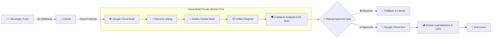

# CloudBuild Pro – CI/CD Pipeline with Approval Gates

[](https://cloud.google.com)
[](https://cloud.google.com/build)
[](https://cloud.google.com/artifact-registry)
[](https://cloud.google.com/run)
[](https://python.org)
[](https://getbootstrap.com)
[](LICENSE)

An enterprise-grade DevOps platform and visual control center demonstrating automated CI/CD pipelines with **Google Cloud Build**, **Google Artifact Registry**, **Google Cloud Run**, and **IAM-Governed Manual Approval Gates**.

Built specifically for the Google Cloud DevOps & Architecture Hackathon to showcase zero-downtime canary delivery, supply-chain container security, and human-in-the-loop release governance.

---

## 🌟 Table of Contents
1. [Project Overview](#-project-overview)
2. [Why Manual Approval Gates?](#-why-manual-approval-gates)
3. [Architecture Overview](#-architecture-overview)
4. [Key Features](#-key-features)
5. [Technology Stack](#-technology-stack)
6. [Interactive DevOps Dashboard](#-interactive-devops-dashboard)
7. [Local Quickstart](#-local-quickstart)
8. [Docker Containerization](#-docker-containerization)
9. [Google Cloud Build & Approval Gate Deployment](#-google-cloud-build--approval-gate-deployment)
10. [REST API Endpoints](#-rest-api-endpoints)
11. [Screenshots & Visual Tour](#-screenshots--visual-tour)
12. [Future Enhancements](#-future-enhancements)
13. [License](#-license)

---

## 🚀 Project Overview

Modern enterprise software delivery requires a balance between **rapid automated velocity** and **strict production governance**. While automated unit tests and security scanners eliminate obvious errors, critical banking, healthcare, and high-concurrency systems mandate authorized human sign-off before code reaches end users.

**CloudBuild Pro** delivers a state-of-the-art DevOps control dashboard that visually models and interacts with this full enterprise delivery lifecycle:
- Source control webhooks from **GitHub Enterprise**
- Serverless orchestration and parallel testing in **Google Cloud Build**
- Multi-stage container compilation using **Kaniko layer caching**
- OCI image provenance and CVE vulnerability scanning in **Google Artifact Registry**
- **Manual Approval Gate** enforcement requiring `roles/cloudbuild.approver` sign-off
- Zero-downtime, autoscaling deployment with traffic migration on **Google Cloud Run**

---

## 🛡️ Why Manual Approval Gates?

In high-compliance environments (SOC2 Type II, HIPAA, PCI-DSS, ISO 27001), automated CD directly to production introduces regulatory and operational risks:
1. **Change Window Coordination:** Releases must align with business schedules, maintenance periods, or low-traffic intervals.
2. **Four-Eyes Principle / Separation of Duties:** Developers who author code cannot unilaterally promote it to production without independent manager verification.
3. **Pre-Flight Sanity Checks:** Allows managers to inspect smoke-test results on staging before routing 100% of global traffic.
4. **Non-Repudiation Audit Trails:** Every approve or reject decision is cryptographically signed and archived in **Google Cloud Audit Logs**.

---

## 📐 Architecture Overview



### Component Breakdown
| Component | GCP Service | Enterprise Role |
| :--- | :--- | :--- |
| **Source Control** | GitHub Enterprise | Houses source code, triggers cryptographically signed webhooks on push. |
| **CI Orchestrator** | Google Cloud Build | Serverless compute pool executing tests, linting, and build steps. |
| **Packaging Engine** | Kaniko / Docker | Secure container image compilation without root privileges. |
| **Image Repository** | Google Artifact Registry | OCI registry with regional storage and vulnerability scanning. |
| **Vulnerability Gate**| Container Analysis | Enforces zero Critical/High CVE policy before promotion. |
| **Governance Barrier**| Cloud Build Approval Gate | Pauses execution awaiting `roles/cloudbuild.approver` authorization. |
| **Serverless Compute**| Google Cloud Run | Zero-to-hero auto-scaling container engine with traffic splitting. |
| **Edge Delivery** | Cloud Load Balancing | Global Anycast IP network with Cloud CDN caching and Cloud Armor WAF. |

---

## ✨ Key Features

- **Google Cloud Enterprise Theme:** High-density glassmorphism UI styled with authentic Google Cloud primary colors (`#4285F4`, `#34A853`, `#FBBC05`, `#EA4335`).
- **Interactive Approval Gate:** Real-time state machine allowing users to test Approve and Reject transitions directly in the browser with live toast notifications.
- **9-Stage Interactive Visual Pipeline:** Click any stage node to inspect real Cloud Build execution logs, inputs, outputs, and GCP service metadata.
- **One-Click Pipeline Simulation:** Watch the entire CI/CD flow run step-by-step from Git checkout to live Cloud Run rollout.
- **Audited Build History:** 15+ comprehensive historical records with live search, environment filtering (Dev, Staging, Prod), status filters, and terminal log modal viewer.
- **Real-Time DevOps Charts:** Chart.js powered telemetry including Weekly Build Volumes, Deployment Trends, Outcome Distribution, and Approval Statistics.
- **Dark/Light Mode:** Seamless enterprise theme switcher with persistent local storage.
- **Production-Ready Docker & Cloud Build Config:** Includes `Dockerfile` optimized with `python:3.11-slim`, non-root user, and production `cloudbuild.yaml`.

---

## 💻 Technology Stack

### Backend
- **Python 3.11 / 3.14**
- **Flask 3.x** – Microframework handling routing, telemetry state, and REST endpoints
- **Jinja2** – Reusable server-side templates with context injection
- **Gunicorn 21.x** – Production WSGI HTTP server

### Frontend
- **HTML5 & Vanilla CSS3** – Glassmorphism, animations, custom design system
- **Bootstrap 5.3** – High-density responsive layout grid
- **JavaScript (ES6+)** – Client-side state transitions, live search, and interactive simulator
- **Chart.js 4.4** – Dynamic SVG/Canvas performance charts
- **Font Awesome 6.5** – Cloud infrastructure iconography

---

## 📊 Interactive DevOps Dashboard

The dashboard provides single-pane-of-glass observability into:
1. **7 High-Level Widgets:**
   - Latest Build (`cb-94821-prod`)
   - Today's Deployments (14 successful)
   - Approval Requests (1 Pending Gate)
   - Failed Builds (1 in 24h)
   - Average Build Time (2m 18s)
   - Connected Repositories (8 Repos)
   - Deployment Success Rate (98.6%)
2. **7 Status Cards:** Repository Connected, Latest Commit, Cloud Build Status, Artifact Registry, Approval Gate, Deployment Status, and Cloud Run.
3. **Circular Progress Health Gauge:** Real-time SLA reliability index.
4. **Live Execution Timeline:** Granular step duration breakdown with timestamps.

---

## 🏃 Local Quickstart

### Prerequisites
- Python 3.10+
- Git

### Installation
```bash
# 1. Clone repository
git clone https://github.com/GoogleCloudPlatform/cloudbuild-pro.git
cd cloudbuild-pro

# 2. Create virtual environment
python -m venv venv
# Linux / macOS:
source venv/bin/activate
# Windows:
venv\Scripts\activate

# 3. Install dependencies
pip install -r requirements.txt

# 4. Run unit tests
python -m unittest discover tests/

# 5. Start application
python main.py
```

The application will be running at **`http://localhost:8080`**.

---

## 🐳 Docker Containerization

### Build Image
```bash
docker build -t cloudbuild-pro:v2.4.1 .
```

### Run Container Locally
```bash
docker run -p 8080:8080 \
  -e PORT=8080 \
  -e ENV=production \
  --name cloudbuild-pro-app \
  cloudbuild-pro:v2.4.1
```

Visit `http://localhost:8080` in your browser. Verify container health:
```bash
curl http://localhost:8080/api/health
```

---

## ☁️ Google Cloud Build & Approval Gate Deployment

### 1. Authenticate with Google Cloud
```bash
gcloud auth login
gcloud config set project YOUR_PROJECT_ID
```

### 2. Enable Required APIs
```bash
gcloud services enable \
    cloudbuild.googleapis.com \
    artifactregistry.googleapis.com \
    run.googleapis.com \
    containeranalysis.googleapis.com
```

### 3. Create Artifact Registry Repository
```bash
gcloud artifacts repositories create cloudbuild-pro-repo \
    --repository-format=docker \
    --location=us-central1 \
    --description="CloudBuild Pro OCI Docker repository"
```

### 4. Create Cloud Build Trigger with Manual Approval Gate
To enable manual approvals in Google Cloud Build:
```bash
gcloud alpha builds triggers create manual \
    --name="cloudbuild-pro-prod-pipeline" \
    --region="us-central1" \
    --repo="https://github.com/YOUR_ORG/cloudbuild-pro" \
    --branch="main" \
    --build-config="cloudbuild.yaml" \
    --substitutions="_REGION=us-central1,_SERVICE_NAME=cloudbuild-pro,_AR_REPO=us-central1-docker.pkg.dev/YOUR_PROJECT_ID/cloudbuild-pro-repo" \
    --require-approval
```

### 5. Assign Approval Permissions to Managers
```bash
gcloud projects add-iam-policy-binding YOUR_PROJECT_ID \
    --member="user:devops-manager@enterprise.gcp" \
    --role="roles/cloudbuild.approver"
```

### 6. Submit a Build Manually
```bash
gcloud builds submit --config=cloudbuild.yaml \
    --substitutions="_REGION=us-central1,_SERVICE_NAME=cloudbuild-pro,_AR_REPO=us-central1-docker.pkg.dev/YOUR_PROJECT_ID/cloudbuild-pro-repo"
```

---

## 🔌 REST API Endpoints

| Method | Endpoint | Description |
| :--- | :--- | :--- |
| `GET` | `/api/health` | Container health check (returns `200 OK` with revision metadata) |
| `GET` | `/api/pipeline/status` | Current approval gate state, commit hash, and deployment telemetry |
| `POST` | `/api/pipeline/approve`| Simulates manager approval; advances deployment to completed |
| `POST` | `/api/pipeline/reject` | Simulates manager rejection; safely cancels release |
| `POST` | `/api/pipeline/trigger`| Queues a new simulated Cloud Build execution |
| `GET` | `/api/builds` | Returns historical build records with query filters (`?env=prod&status=success&search=feat`) |

---

## 📸 Screenshots & Visual Tour

> Placeholder images for hackathon presentation slides and documentation:

- **Dashboard:** Modern dark glassmorphism layout with 7 status cards, live circular gauge, and Chart.js telemetry.
- **Pipeline Visualizer:** Interactive 9-stage workflow with step inspector drawer and live log console.
- **Approval Gate Action:** Visual demonstration of manager sign-off transitioning to 100% Cloud Run deployment.
- **Build History:** High-density audited log table with live multi-filter search and full terminal modal.
- **Architecture Diagram:** Interactive component flowchart illustrating Google Cloud native delivery.

---

## 🔮 Future Enhancements

1. **AI Anomaly Detection:** Connect Gemini 1.5 Pro to parse raw Cloud Build build logs and automatically provide root-cause analysis on failure.
2. **Automated Canary Metric Rollbacks:** Cloud Monitoring SLA policies triggering automated Cloud Run traffic rollback if 5xx errors exceed 0.5%.
3. **Multi-Region Synchronized Approvals:** Coordinated staging across `us-central1`, `europe-west1`, and `asia-east1`.
4. **Binary Authorization Attestation Signer:** Cryptographic attestation generation using Cloud KMS asymmetric keys.

---

## 📄 License

This project is licensed under the MIT License – see the [LICENSE](LICENSE) file for details.

---

*Developed with ❤️ for Google Cloud Hackathon 2026.*
